# Sayso: Architecture and End-to-End Flows

> Version 0.2, 13 Nov 2026 (matches BUILD_PLAN.md: on-device speech, Gemini, Cloudflare). This document shows **how everything flows**, from the user's voice to an action on screen.
> Related: [PRD.md](PRD.md) · [TECHNICAL_ARCHITECTURE.md](TECHNICAL_ARCHITECTURE.md)
> Diagrams use Mermaid (render in GitHub, VS Code, or any Mermaid viewer).

---

## 1. The big picture

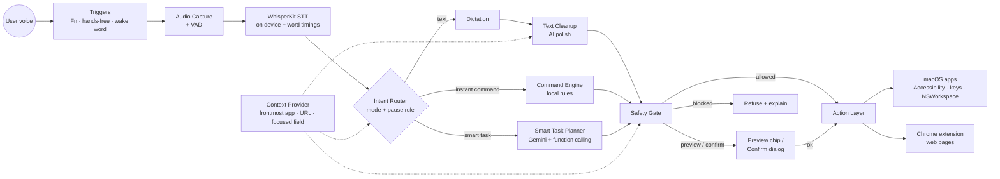

**Three paths, one pipeline:**
| Path | Example | AI used? | Speed |
|---|---|---|---|
| Dictation | "Hey, can we meet at 5 tomorrow" | Yes (cleanup) | ~0.5-0.7 s |
| Instant command | "send", "click Recompile", "open GitHub" | No | < 300 ms |
| Smart task | "In GitHub, create a repo called instance" | Yes (planner) | 1-60 s |

## 2. System components and where they run

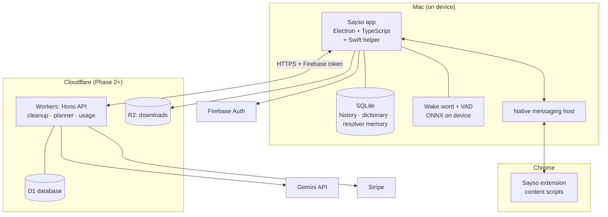

**Data that leaves the Mac:** text for cleanup and the minimum screen context for smart tasks the user starts. **Data that never leaves:** audio (speech-to-text runs on device), wake-word audio, history, passwords, full screenshots (vision fallback later, and then only with permission).

## 3. Listening state machine

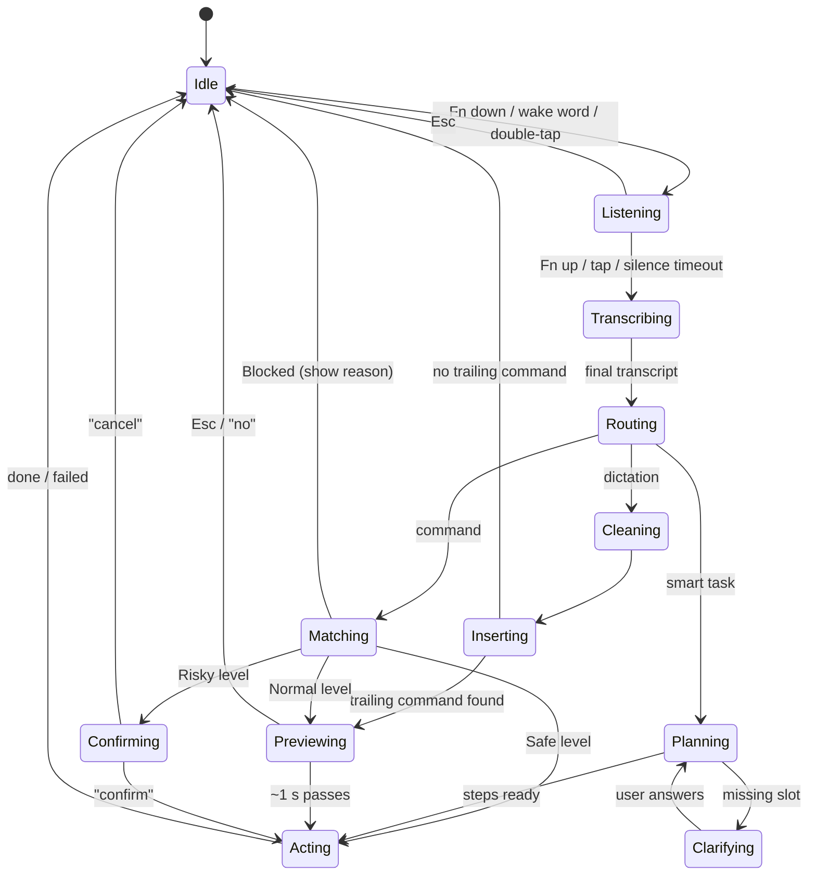

## 4. Flow A: dictate and send

User holds Fn: *"Hey, um, can we meet at 5, no, 6 tomorrow? … send"* (pause before "send").

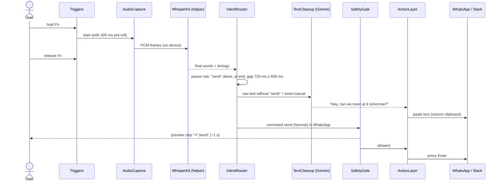

**If "send" had no pause before it, or had words after it** ("send me a flower"), the router keeps it as text and nothing is sent.

## 5. Flow B: instant command "click Recompile"

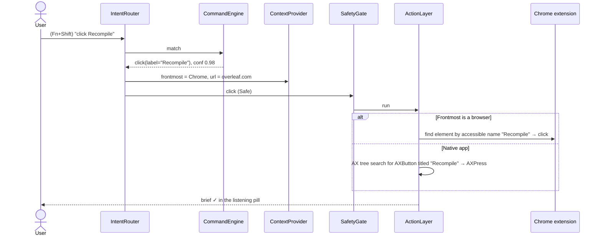

**Matching rules for labels:** exact match → case-insensitive → contains → fuzzy (≥ 0.85). If more than one element matches, show numbered badges on screen and the user says "one" / "two".

## 6. Flow C: "open GitHub" (resolver)

```mermaid
flowchart TD
  S["open GitHub" / "open GitHub in Chrome"] --> B{Browser named?}
  B -->|yes| URL[Resolve site URL → open in that browser]
  B -->|no| M{Remembered choice?}
  M -->|yes| DO[Open remembered target]
  M -->|no| A{Installed app match?}
  A -->|yes| W{Also a known website?}
  W -->|no| OA[Open app]
  W -->|yes| ASK[Chip: 'GitHub Desktop or github.com?'<br/>→ remember answer]
  A -->|no| K{Known site / bookmark / history?}
  K -->|yes| OU[Open URL in default browser]
  K -->|no| GS[Web search in default browser]
```

## 7. Flow D: smart task (V2), "In GitHub, create a new repo called instance"

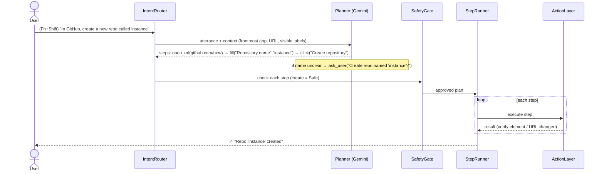

**Verification:** after each step, the runner checks that the expected change happened (new URL, field value, element present). If not, it retries once, then stops and shows what failed. It never reports success without checking.

**Optional connector path:** if the GitHub connector is enabled, the planner returns one `apiCall(github.createRepo)` step instead of clicks (≈ 1 s).

## 8. Flow E: multi-step task (V2), the Overleaf resume example

*"Open Overleaf, create LaTeX from my resume, paste it, recompile and download."*

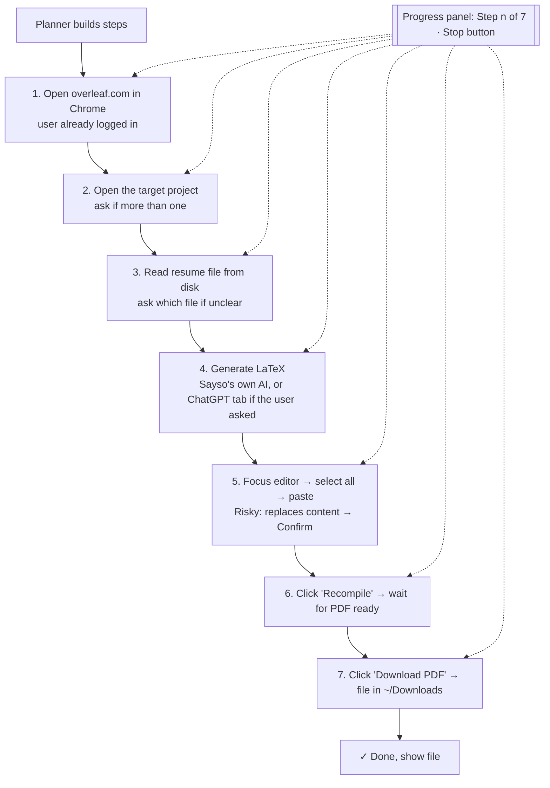

## 9. Flow F: multiple laptops side by side (V2)

Each laptop runs its **own independent install**. They are **not linked** and can be on different networks. Each reacts only to **its own trigger**.

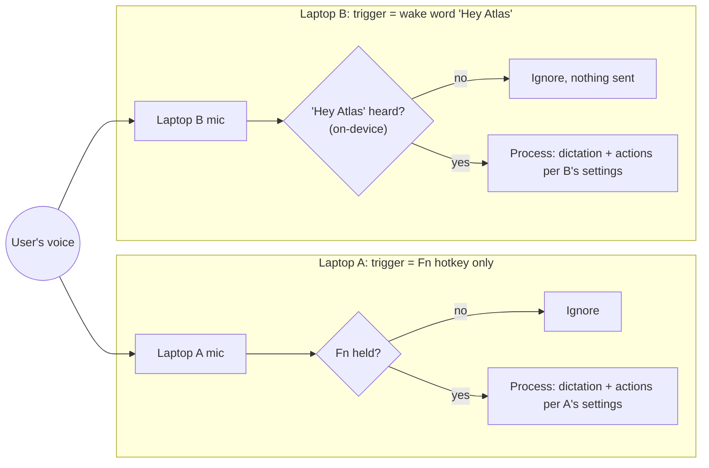

**Example:** hands typing on Laptop A. Voice: *"Hey Atlas, open Claude Code. Pull Jira story 918 and do the work. [pause] Send."*
- Laptop A: Fn not held → ignores.
- Laptop B: wake word matched → opens Claude Code → types the prompt → pause rule → Normal-level send → presses Enter.

Per-device settings (stored locally, optionally synced by `device_id`): dictation on/off, actions on/off, smart tasks on/off, wake word on/off + name, safety unlocks.

## 10. Flow G: Safety Gate decision

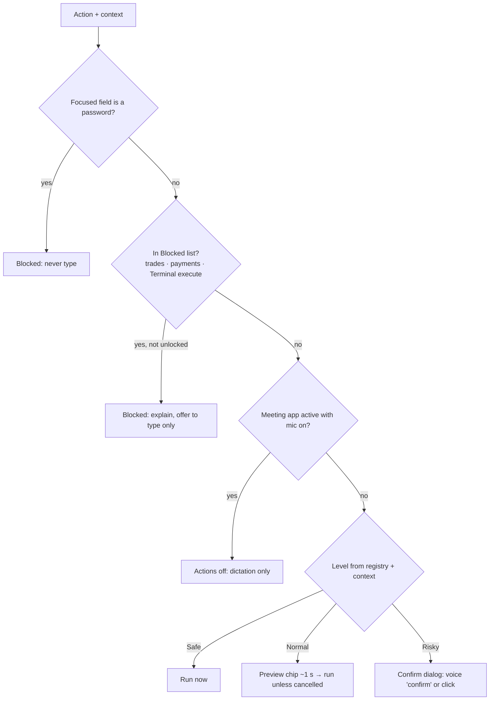

**Risky triggers by context:** recipients > 3; destructive verbs (delete, remove, discard, close without saving); git push / merge / deploy; replacing existing document content; submitting forms with money fields.

## 11. Flow H: text cleanup

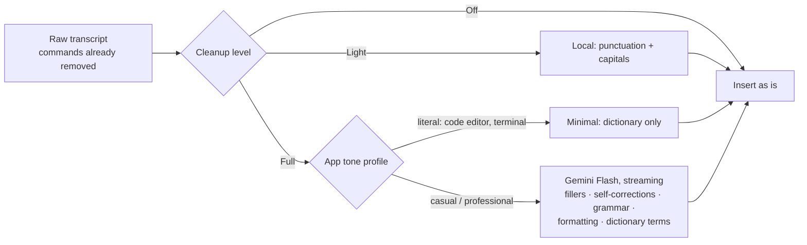

## 12. Account, billing and usage flow

```mermaid
sequenceDiagram
  actor User
  participant App as Mac app
  participant API as Cloudflare Worker
  participant Auth as Firebase Auth
  participant Stripe
  User->>App: Sign in with Google
  App->>Auth: Firebase Auth (browser sign-in)
  Auth-->>App: Firebase ID token (stored with safeStorage)
  App->>API: requests carry the ID token; Worker verifies it
  App->>API: GET /v1/me → plan = trial, limits
  User->>App: Upgrade
  App->>API: POST /v1/billing/checkout
  API->>Stripe: create Checkout session
  Stripe-->>User: payment page (browser)
  Stripe->>API: webhook: subscription active
  API-->>App: next /v1/me → plan = pro
  App->>API: batched usage events (words, commands, tasks)
```

## 13. Deployment view

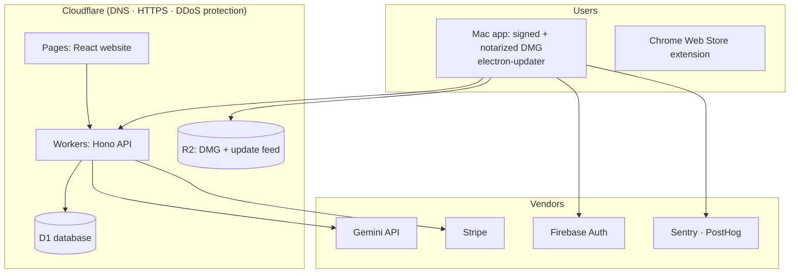

## 14. Version map: what flows exist in each version

| Flow | V1 | V2 | V3 | V4 |
|---|---|---|---|---|
| A. Dictate + send | ✅ | ✅ | ✅ | ✅ |
| B. Instant commands / click by label | ✅ | ✅ | ✅ + vision fallback | ✅ |
| C. Open resolver | ✅ | ✅ | ✅ | ✅ |
| D. Smart task | | ✅ | ✅ | ✅ |
| E. Multi-step task | | ✅ | ✅ | ✅ |
| F. Multiple laptops (wake word per device) | | ✅ | ✅ | ✅ |
| G. Safety Gate | ✅ | ✅ | ✅ | ✅ |
| H. Cleanup | ✅ | ✅ | ✅ | ✅ + translation (Telugu, Hindi, Hinglish → English) |
| Windows | | | ✅ | ✅ |
